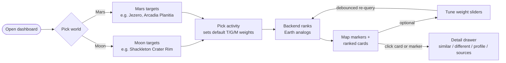
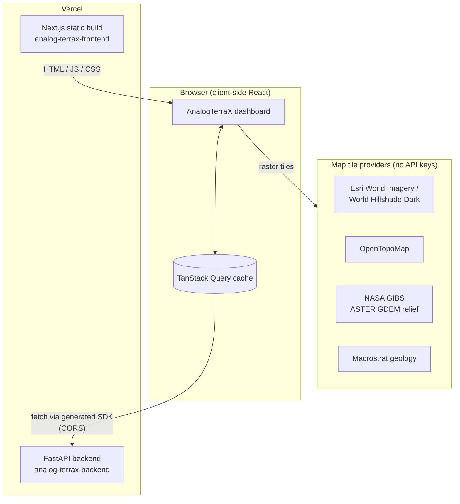
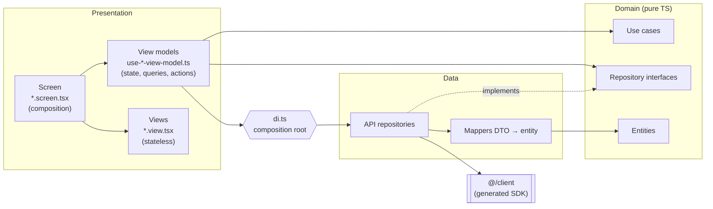
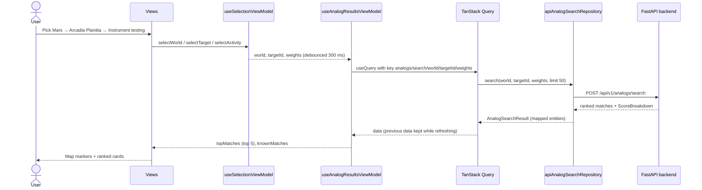
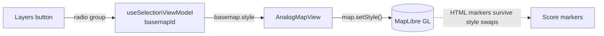
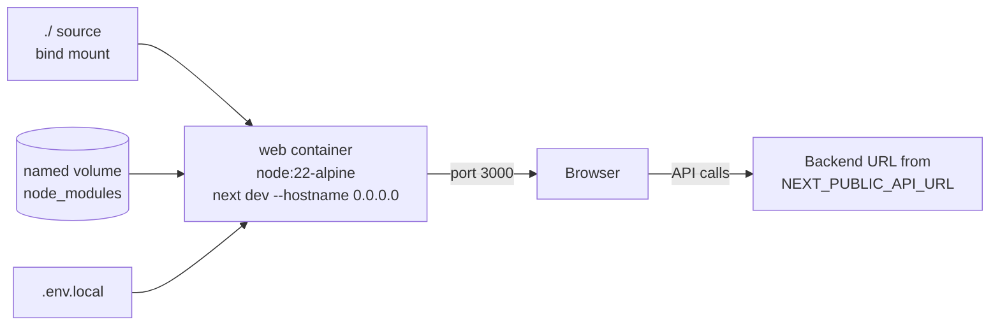
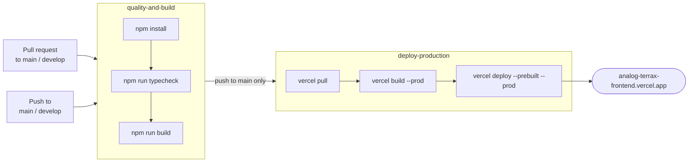
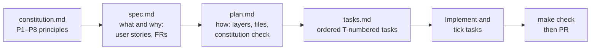

# AnalogTerraX — Frontend

> Earth analogs for the Moon base and Mars sites.
> Built for the **NASA Space Apps Challenge 2026** ("Identify Earth Locations that Analog the Permanent Moon Base Locations and Mars") by a team in Riobamba, Ecuador.

AnalogTerraX is a one-page mission-control dashboard. You pick a world (Moon or Mars), a target site and an activity. It then ranks **candidate Earth analog sites** by how closely they match the target in **topography, geology and mineralogy**. Similarity comes from data (slope, roughness, rock type, minerals), never from "looks similar". Every result also says where the analogy breaks down.

| | |
|---|---|
| **Live app** | https://analog-terrax-frontend.vercel.app |
| **Backend API** | https://analog-terrax-backend.vercel.app ([FastAPI](https://fastapi.tiangolo.com/), OpenAPI at `/openapi.json`) |
| **Stack** | Next.js 15 · React 19 · TypeScript (strict) · Tailwind CSS v4 · TanStack Query · MapLibre GL · Chart.js |
| **Architecture** | Clean architecture + MVVM, one vertical slice per feature |
| **Workflow** | Spec-Driven Development (GitHub Spec Kit layout) |

---

## Table of contents

1. [Features](#features)
2. [User flow](#user-flow)
3. [Tech stack](#tech-stack)
4. [System architecture](#system-architecture)
5. [Code architecture (MVVM + clean architecture)](#code-architecture-mvvm--clean-architecture)
6. [Project structure](#project-structure)
7. [Data flow: ranking a target](#data-flow-ranking-a-target)
8. [Backend API contract](#backend-api-contract)
9. [Scoring and activity weights](#scoring-and-activity-weights)
10. [Map layers](#map-layers)
11. [Getting started](#getting-started)
12. [Make targets](#make-targets)
13. [Environment variables](#environment-variables)
14. [Quality gates](#quality-gates)
15. [CI/CD](#cicd)
16. [Spec-Driven Development](#spec-driven-development)
17. [Known limitations](#known-limitations)
18. [Documentation index](#documentation-index)

---

## Features

| Area | What it does |
|---|---|
| **World and target selection** | Moon/Mars toggle in the icon rail. The target list comes from the backend (`GET /bodies/{body}/sites`) and is never hardcoded. |
| **Activities** | Six mission activities (rover, drilling, construction, EVA, instruments, landing). Each one sets default T/G/M weights and "what you could test here" ideas. |
| **Ranked results** | The top 5 Earth analogs as cards, each with an overall match (0–100) and topography, geology and mineralogy sub-scores. |
| **Earth map** | MapLibre GL map with score-coloured markers, grey known-analog markers, a score legend, a metric scale bar, fullscreen, and a layer switcher (Satellite, Topographic, NASA relief, Geology). |
| **Weight sliders** | Three T/G/M sliders. Changes are debounced (300 ms) and re-query the backend; the previous results stay on screen until new ones arrive. |
| **Analog detail drawer** | Radar chart, ring gauges, "Similar in" and **"Different in"** lists (always visible), test ideas, ICESat-2 vs LOLA/MOLA laser profile, data sources, and the Earth limits note. |
| **Honesty by design** | Every site is a *"candidate analog to evaluate"*, never "official". An "Earth limits" note is always shown in the detail drawer, and a "Demo data" banner appears while the backend serves placeholder data. |
| **Resilience** | TanStack Query caches the demo path (`staleTime: Infinity`), and a clear error state with retry replaces blank screens when the backend is unreachable. |
| **Accessibility** | WCAG 2.1 AA contrast, full keyboard navigation (native `<dialog>`, radio groups, focus return), and scores always shown as numbers, never by colour alone. |

---

## User flow



**Demo script (~2 min):**

1. **Moon → Shackleton Crater Rim → Rover mobility**: the top analogs appear on the map, with known analogs in grey.
2. **Mars → Arcadia Planitia → Instrument testing**: the weights switch to 0.1 / 0.3 / 0.6 and the ranking changes.
3. **Open the top card**: radar chart, similar/different lists, laser profile.
4. **Point to the Earth limits note and the data sources.**

---

## Tech stack

| Layer | Technology | Why |
|---|---|---|
| Framework | [Next.js 15](https://nextjs.org/) (App Router, Turbopack dev server) | Static prerendered page, simple Vercel deploy |
| UI runtime | React 19 | Arrow function components, hooks-based view models |
| Language | TypeScript 5 (`strict`, no `any`) | Types generated from the backend's OpenAPI spec |
| Styling | Tailwind CSS v4 (`@theme` design tokens in `globals.css`) | Dark glass design system without a component library |
| Server state | [TanStack Query v5](https://tanstack.com/query) | Caching, `keepPreviousData`, retry and error states |
| API client | [`@hey-api/openapi-ts`](https://heyapi.dev/) + `@hey-api/client-fetch` | Typed SDK generated into `src/client/` (never edited by hand) |
| Map | [MapLibre GL JS 6](https://maplibre.org/) + raster tile sources | Open-source WebGL map with no API keys |
| Charts | Chart.js 4 + `react-chartjs-2` (radar), plain SVG (laser profile) | Lightweight; the radar is lazy-loaded with `next/dynamic` |
| Validation | Zod | Env vars validated at startup (`src/env.ts`) |
| Icons and type | Lucide React, Inter (`next/font`) | Consistent 1.5px stroke icons, no emoji |
| Hosting | Vercel | Deployed from `main` by CI |

---

## System architecture

The browser calls the FastAPI backend **directly**; there are no Next.js API routes or proxies. The Next.js app is a statically prerendered shell, and all data fetching happens client-side.



> **CORS note:** the backend allows `http://localhost:3000` and `https://analog-terrax-frontend.vercel.app`. Use `localhost`, not `127.0.0.1`, in development.

---

## Code architecture (MVVM + clean architecture)

Each feature is a vertical slice under `src/features/<feature>/` with four parts and one **dependency rule**: views → view models → domain ← data.



| Layer | Folder | Contains | Must not |
|---|---|---|---|
| **Domain** | `domain/` | Entities (`Site`, `AnalogMatch`, `Weights`…), pure use cases (`splitHighlights`), repository interfaces | Import React, `fetch` or `@/client` |
| **Data** | `data/` | Repositories that wrap the generated SDK, mappers from API DTOs to domain entities, static feature config (`activities.ts`) | Contain UI or React state |
| **View models** | `presentation/view-models/` | `use-*-view-model.ts` hooks: React state, TanStack Query calls, derived data and actions | Render JSX |
| **Views** | `presentation/views/` | Stateless arrow components that render view-model output | Fetch data or hold business logic |
| **Composition** | `di.ts`, `*.screen.tsx` | Wires concrete repositories to interfaces (DIP) and composes views with view models | — |

**Principles applied:** SOLID (single-purpose files, small repository interfaces, dependency inversion through `di.ts`), functional style (`map`/`filter`/`reduce`, no loops, immutable data), and every UI string goes through the i18n catalog (`src/shared/i18n`).

---

## Project structure

```text
analog-terrax-frontend/
├── .github/workflows/ci.yml        # Typecheck + build on PRs; deploy to Vercel on main
├── .specify/                       # Spec Kit: constitution (P1–P8) and templates
├── docs/
│   ├── coding-guidelines.md        # MVVM + clean architecture rules and examples
│   └── design-guidelines.md        # Dark glass design system: tokens, layout, components
├── specs/001-analog-finder/        # spec.md → plan.md → tasks.md for the dashboard
├── src/
│   ├── app/                        # Thin App Router layer: layout, page, error boundaries, globals.css
│   ├── client/                     # GENERATED OpenAPI SDK (sdk.gen.ts, types.gen.ts) — never edit
│   ├── env.ts                      # Zod-validated NEXT_PUBLIC_* env vars
│   ├── lib/api-client.ts           # apiFetch used by the generated client (errors, request id)
│   ├── providers/                  # QueryClientProvider (created with useState for SSR safety)
│   ├── features/
│   │   ├── analog-finder/          # The dashboard (vertical slice)
│   │   │   ├── domain/
│   │   │   │   ├── entities/       # Site, AnalogMatch, Aspect/Weights, Activity, Highlight, LaserProfile
│   │   │   │   ├── repositories/   # SiteRepository, AnalogSearchRepository, ProfileRepository
│   │   │   │   └── use-cases/      # split-highlights.ts (+ assert-based .check.ts)
│   │   │   ├── data/
│   │   │   │   ├── mappers/        # API DTO → domain entity
│   │   │   │   ├── repositories/   # api-analog.repositories.ts (wraps @/client)
│   │   │   │   └── activities.ts   # Six activities: default weights + test ideas
│   │   │   ├── presentation/
│   │   │   │   ├── view-models/    # selection, targets, analog results, analog detail
│   │   │   │   ├── views/          # rail, lists, map, layer switcher, legend, drawer, profile…
│   │   │   │   └── analog-finder.screen.tsx
│   │   │   └── di.ts               # Composition root
│   └── shared/
│       ├── config/                 # app-config, basemaps, data sources
│       ├── i18n/                   # String catalog (en)
│       ├── lib/                    # cn(), formatters, score tone, debounce, world colours
│       └── ui/                     # Design-system components (glass card, ring gauge, radar…)
├── Dockerfile.dev · compose.dev.yaml   # Development-only container
├── Makefile                        # Task runner (run `make` for the list)
└── openapi-ts.config.ts            # SDK generator config
```

---

## Data flow: ranking a target



**Query cache keys:**

| Query key | Source | Cache policy |
|---|---|---|
| `["sites", world]` | `GET /bodies/{body}/sites` | `staleTime: Infinity` |
| `["analogs", "search", world, targetId, weights]` | `POST /analogs/search` | `staleTime: Infinity`, `placeholderData: keepPreviousData` |
| `["analogs", "profile", cellId, targetId]` | `GET /analogs/{cell}/profile` | `staleTime: Infinity`, only fetched while the drawer is open |

---

## Backend API contract

The SDK in `src/client/` is generated from the backend's OpenAPI spec (`make api`). Only the data layer imports it.

| SDK function | Endpoint | Used for |
|---|---|---|
| `planetaryListBodySites(body)` | `GET /api/v1/bodies/{body}/sites` | Target and Earth site lists (`PlanetarySite`) |
| `analogsSearchEarthAnalogs(req)` | `POST /api/v1/analogs/search` | Ranked matches with weights, filters and `k` |
| `analogsGetLaserProfileComparison(cell, target)` | `GET /api/v1/analogs/{cell}/profile` | ICESat-2 vs LOLA/MOLA elevation transects |
| `analogsGetEarthAnalogHeatmap(params)` | `GET /api/v1/analogs/heatmap` | Global score layer (not used yet) |
| `planetaryGetTaxonomy()` | `GET /api/v1/taxonomy` | Feature and lithology labels (not used yet) |
| `systemGetHealth()` | `GET /api/v1/health` | Backend health (in the SDK; not shown in the UI) |

Search request filters sent by the frontend: `curated_only: true`, `exclude_vegetated: true`, `max_ndvi: 0.3`.

> Adding a site or target is a **backend data change**: it needs no frontend code change (constitution P1).

---

## Scoring and activity weights

The **backend computes every score** (constitution P4). The frontend only sends weights and renders the returned `ScoreBreakdown` (`overall_pct`, `topography_score`, `geology_score`, `mineralogy_score`). Default weights per activity live in `src/features/analog-finder/data/activities.ts` until the backend exposes activities.

| Activity | Topography | Geology | Mineralogy |
|---|:-:|:-:|:-:|
| Rover mobility and navigation | 0.6 | 0.3 | 0.1 |
| Drilling and sampling | 0.1 | 0.4 | 0.5 |
| Construction and regolith handling | 0.3 | 0.4 | 0.3 |
| Spacesuit / EVA field operations | 0.5 | 0.3 | 0.2 |
| Instrument testing | 0.1 | 0.3 | 0.6 |
| Landing site and hazard assessment | 0.7 | 0.2 | 0.1 |

**Score tones and highlight thresholds** (`src/shared/config/app-config.ts`, `src/shared/lib/score-tone.ts`):

| Rule | Value |
|---|---|
| High / Medium / Low match | ≥ 80 / ≥ 60 / < 60 |
| "Similar in" feature | closeness ≥ 85 % |
| "Different in" feature | closeness < 70 % |
| "Different in" aspect | sub-score < 0.7 |
| "Different in" lithology | dominant rock type differs between target and Earth site |

---

## Map layers

All layers are raster tile sources defined in `src/shared/config/basemaps.ts`. None needs an API key, and each carries its own attribution.

| Layer | Source | Max zoom | Supports |
|---|---|:-:|---|
| **Satellite** (default) | Esri World Imagery | 18 | Real surface colour: lava fields, salt flats, dunes |
| **Topographic** | OpenTopoMap | 17 | Contour lines → **topography** |
| **NASA relief** | NASA GIBS `ASTER_GDEM_Color_Shaded_Relief` | 12 | Elevation from NASA data |
| **Geology** | Macrostrat bedrock units (75 % opacity) over Esri World Hillshade Dark | 14 / 16 | Rock units → **geology** |



---

## Getting started

### Prerequisites

| Tool | Version | Notes |
|---|---|---|
| Node.js | 22 (same as CI) | `npm` ships with it |
| Docker Desktop | optional | Only for the dev container |
| Backend | deployed or local | Point `NEXT_PUBLIC_API_URL` at it |

### Run locally

```bash
cp .env.example .env.local
```

Set `NEXT_PUBLIC_API_URL="https://analog-terrax-backend.vercel.app"` in `.env.local` to use the deployed backend, or keep `http://localhost:8000` for a local one. Then:

```bash
make install
```

```bash
make dev
```

Open http://localhost:3000 (use `localhost`, not `127.0.0.1`, because of backend CORS).

### Run in Docker (development only)

```bash
make up
```



Hot reload works through the bind mount (`WATCHPACK_POLLING`). Run `make rebuild` after changing `package.json`, because `node_modules` lives in a named volume.

### Regenerate the API client

```bash
make api
```

This regenerates `src/client/` from `http://localhost:8000/openapi.json`. To generate from a sibling backend checkout instead, use `npm run generate:api:file` (reads `../analog-terrax-backend/openapi.json`).

---

## Make targets

Run `make` with no arguments to list them.

| Target | What it runs | When |
|---|---|---|
| `make install` | `npm install` | First setup |
| `make dev` | `next dev --turbopack` on :3000 | Daily development |
| `make api` | `openapi-ts` → `src/client/` | Backend API changed |
| `make build` | `next build` | Production build |
| `make start` | build + `next start` | Test the production build locally |
| `make typecheck` | `tsc --noEmit` | Type safety |
| `make domain` | Every `*.check.ts` via `tsx` | Domain use-case checks |
| `make doctor` | `npx react-doctor@latest` | React code analysis |
| `make check` | typecheck → domain → build → doctor | Before opening a PR |
| `make up` / `down` | Dev container start / stop | Docker workflow |
| `make logs` / `shell` | Follow logs / shell into the container | Docker debugging |
| `make rebuild` | Recreate the image and `node_modules` volume | After `package.json` changes |
| `make clean` | Remove `.next` | Stale build output |

---

## Environment variables

Validated with Zod in `src/env.ts` and exposed through `src/shared/config/app-config.ts`. Both are `NEXT_PUBLIC_*`, so they are **inlined into the client bundle at build time**: never put secrets in them.

| Variable | Default | Purpose |
|---|---|---|
| `NEXT_PUBLIC_API_URL` | `http://localhost:8000` | Backend base URL, called from the browser. Deployed: `https://analog-terrax-backend.vercel.app` |
| `NEXT_PUBLIC_DEMO_DATA` | `"true"` | Shows the "Demo data" banner while the backend serves placeholder data |

App constants in `app-config.ts`:

| Constant | Value | Meaning |
|---|---|---|
| `topN` | 5 | Ranked results shown on the map and list |
| `searchLimit` | 50 | `k` sent to the search endpoint (the rest feed the known-analog markers) |
| `weightsDebounceMs` | 300 | Delay before slider changes re-query |

---

## Quality gates

| Gate | Command | Checks |
|---|---|---|
| Types | `make typecheck` | TypeScript strict mode, no `any` |
| Domain logic | `make domain` | Assert-based `*.check.ts` files (no test runner needed) |
| Build | `make build` | Next.js production build and static prerender |
| React analysis | `make doctor` | react-doctor: accessibility, performance and correctness rules |
| All of the above | `make check` | Run before every PR |

> `npm run lint` needs ESLint, which is not installed.

---

## CI/CD

GitHub Actions workflow `.github/workflows/ci.yml` (Node 22):



The deploy job needs the `VERCEL_TOKEN`, `VERCEL_ORG_ID` and `VERCEL_PROJECT_ID` repository secrets. Without a token it exits cleanly and relies on the Vercel GitHub integration.

Manual deploy:

```bash
vercel link --yes --project analog-terrax-frontend
```

```bash
vercel env add NEXT_PUBLIC_API_URL production
```

```bash
vercel deploy --prod
```

---

## Spec-Driven Development

Every feature starts with a spec before any code, following the [GitHub Spec Kit](https://github.com/github/spec-kit) layout.



**Constitution principles** ([`.specify/memory/constitution.md`](.specify/memory/constitution.md)):

| # | Principle | In short |
|---|---|---|
| P1 | Data-driven | All sites and scores come from the backend; adding a site needs no frontend change |
| P2 | Honest results | "Different in" and Earth limits always visible; "candidate analog", never "official" |
| P3 | Resilient demo | Client cache for the demo path, clear error states, one-command build |
| P4 | Backend scoring | The frontend never computes or re-weights geoscience |
| P5 | Clean architecture + MVVM | Layering and dependency rule from the coding guidelines |
| P6 | Accessible | WCAG 2.1 AA, keyboard navigable, numbers never shown by colour alone |
| P7 | Lean | YAGNI; the core demo flow ships first |
| P8 | Consistent UI | Design guidelines and the i18n catalog for every string |

Current feature: [`specs/001-analog-finder/`](specs/001-analog-finder/spec.md).

---

## Known limitations

These are open questions for the backend, tracked as findings F1–F7 in [spec 001](specs/001-analog-finder/spec.md).

| Limitation | Effect in the UI | Needs |
|---|---|---|
| No confidence level in the API | No High/Medium/Low confidence badge yet | Backend field |
| No site images or `scale_label` | No Earth vs Moon/Mars side-by-side image | Backend field |
| No data-source links per site | Sources come from a static frontend list (`shared/config/sources.ts`) | Backend field |
| No activities endpoint | Activities and weights live in frontend config | Backend endpoint |
| `top_contributing_features` returns only the most similar features | "Different in" often shows "No major differences" | Backend should also return least-similar features |
| No Ecuador (Andes case study) sites | Case-study tab not built | Backend data |
| No mineralogy basemap | Map layers cover topography and geology only | A global mineral tile service (e.g. EMIT) |
| MapLibre worker loaded from unpkg | The map needs internet (tiles do too) | Self-host the worker for offline use |

---

## Documentation index

| Document | Content |
|---|---|
| [CLAUDE.md](CLAUDE.md) | Full product brief, API contract and repo conventions |
| [Constitution](.specify/memory/constitution.md) | Non-negotiable principles P1–P8 |
| [Design guidelines](docs/design-guidelines.md) | Colour tokens with contrast ratios, typography, layout, components, motion |
| [Coding guidelines](docs/coding-guidelines.md) | MVVM + clean architecture rules, naming, examples |
| [Spec 001: Analog finder](specs/001-analog-finder/spec.md) | User stories, functional requirements, backend findings |
| [Plan 001](specs/001-analog-finder/plan.md) | Technical plan and constitution check |
| [Tasks 001](specs/001-analog-finder/tasks.md) | Task checklist and progress |
